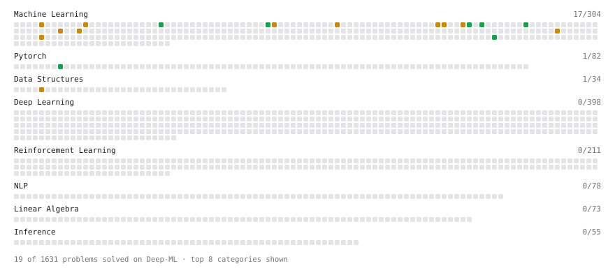

# Deep-ML

My machine learning practice from [Deep-ML](https://www.deep-ml.com). Every solution here was written by hand.

**45** solved · 33 problems · 2 labs · 10 math

[**Browse the interactive portfolio**](https://mittaltanmay.github.io/deep-ml/) to replay this filling in over time.

## Problems

| | Difficulty | Solved | |
| --- | --- | --- | --- |
| [Add a Bias Vector to a Batch via Broadcasting](https://www.deep-ml.com/problems/882) | easy | 2026-10-23 | [solution](problems/0882-add-a-bias-vector-to-a-batch-via-broadcasting) |
| [Backprop a Linear Layer by Hand](https://www.deep-ml.com/problems/898) | easy | 2026-10-26 | [solution](problems/0898-backprop-a-linear-layer-by-hand) |
| [Balance Dataset via Undersampling](https://www.deep-ml.com/problems/1057) | easy | 2026-10-03 | [solution](problems/1057-balance-dataset-via-undersampling) |
| [Build an MLP with nn.Sequential](https://www.deep-ml.com/problems/887) | easy | 2026-09-15 | [solution](problems/0887-build-an-mlp-with-nn-sequential) |
| [Create a Float Tensor from a Python List](https://www.deep-ml.com/problems/880) | easy | 2026-10-23 | [solution](problems/0880-create-a-float-tensor-from-a-python-list) |
| [Derivatives of Activation Functions](https://www.deep-ml.com/problems/217) | easy | 2026-10-22 | [solution](problems/0217-derivatives-of-activation-functions) |
| [Implement a Linear Layer Forward Pass with Matrix Multiplication](https://www.deep-ml.com/problems/883) | easy | 2026-10-23 | [solution](problems/0883-implement-a-linear-layer-forward-pass-with-matrix-multiplication) |
| [Implement Early Stopping Based on Validation Loss](https://www.deep-ml.com/problems/135) | easy | 2026-09-20 | [solution](problems/0135-implement-early-stopping-based-on-validation-loss) |
| [Implement Gini Impurity Calculation for a Set of Classes](https://www.deep-ml.com/problems/64) | easy | 2026-09-20 | [solution](problems/0064-implement-gini-impurity-calculation-for-a-set-of-classes) |
| [Implement Hard Voting Classifier](https://www.deep-ml.com/problems/305) | easy | 2026-10-12 | [solution](problems/0305-implement-hard-voting-classifier) |
| [Implement Hinge Loss for SVM](https://www.deep-ml.com/problems/283) | easy | 2026-10-01 | [solution](problems/0283-implement-hinge-loss-for-svm) |
| [Implement Polynomial Kernel Function](https://www.deep-ml.com/problems/281) | easy | 2026-10-02 | [solution](problems/0281-implement-polynomial-kernel-function) |
| [Implement ReLU and Leaky ReLU](https://www.deep-ml.com/problems/1226) | easy | 2026-10-25 | [solution](problems/1226-implement-relu-and-leaky-relu) |
| [Mean Squared Error from Scratch](https://www.deep-ml.com/problems/1228) | easy | 2026-10-25 | [solution](problems/1228-mean-squared-error-from-scratch) |
| [Reshape and Transpose a Tensor](https://www.deep-ml.com/problems/881) | easy | 2026-10-23 | [solution](problems/0881-reshape-and-transpose-a-tensor) |
| [Single Linear Neuron Forward](https://www.deep-ml.com/problems/1224) | easy | 2026-10-25 | [solution](problems/1224-single-linear-neuron-forward) |
| [Binary Cross-Entropy from Logits](https://www.deep-ml.com/problems/1229) | medium | 2026-10-25 | [solution](problems/1229-binary-cross-entropy-from-logits) |
| [Calculate AUC (Area Under ROC Curve)](https://www.deep-ml.com/problems/277) | medium | 2026-10-06 | [solution](problems/0277-calculate-auc-area-under-roc-curve) |
| [Calculate Explained Variance Ratio for PCA](https://www.deep-ml.com/problems/350) | medium | 2026-09-26 | [solution](problems/0350-calculate-explained-variance-ratio-for-pca) |
| [Derivative of Cross-Entropy Loss w.r.t. Logits](https://www.deep-ml.com/problems/220) | medium | 2026-10-25 | [solution](problems/0220-derivative-of-cross-entropy-loss-w-r-t-logits) |
| [Derivative of Softmax](https://www.deep-ml.com/problems/219) | medium | 2026-10-23 | [solution](problems/0219-derivative-of-softmax) |
| [Find the Best Gini-Based Split for a Binary Decision Tree](https://www.deep-ml.com/problems/138) | medium | 2026-09-20 | [solution](problems/0138-find-the-best-gini-based-split-for-a-binary-decision-tree) |
| [Generate Sorted Polynomial Features](https://www.deep-ml.com/problems/32) | medium | 2026-09-19 | [solution](problems/0032-generate-sorted-polynomial-features) |
| [Handle Imbalanced Data with SMOTE](https://www.deep-ml.com/problems/357) | medium | 2026-10-02 | [solution](problems/0357-handle-imbalanced-data-with-smote) |
| [Implement K-Fold Cross-Validation](https://www.deep-ml.com/problems/18) | medium | 2026-09-26 | [solution](problems/0018-implement-k-fold-cross-validation) |
| [Implement K-Nearest Neighbors](https://www.deep-ml.com/problems/173) | medium | 2026-09-23 | [solution](problems/0173-implement-k-nearest-neighbors) |
| [Implement RBF (Gaussian) Kernel Function](https://www.deep-ml.com/problems/280) | medium | 2026-10-02 | [solution](problems/0280-implement-rbf-gaussian-kernel-function) |
| [Implement ROC Curve Calculation](https://www.deep-ml.com/problems/276) | medium | 2026-10-04 | [solution](problems/0276-implement-roc-curve-calculation) |
| [Numerically Stable Softmax](https://www.deep-ml.com/problems/1227) | medium | 2026-10-25 | [solution](problems/1227-numerically-stable-softmax) |
| [Permutation Feature Importance](https://www.deep-ml.com/problems/812) | medium | 2026-10-08 | [solution](problems/0812-permutation-feature-importance) |
| [Polynomial Regression Fit](https://www.deep-ml.com/problems/801) | medium | 2026-09-19 | [solution](problems/0801-polynomial-regression-fit) |
| [Reconstruction Error from PCA](https://www.deep-ml.com/problems/353) | medium | 2026-09-26 | [solution](problems/0353-reconstruction-error-from-pca) |
| [Two-Layer MLP Forward Pass](https://www.deep-ml.com/problems/1225) | medium | 2026-10-25 | [solution](problems/1225-two-layer-mlp-forward-pass) |

## Labs

| | Difficulty | Solved | |
| --- | --- | --- | --- |
| [Design Your Own Activation Function](https://www.deep-ml.com/labs/9) | easy | 2026-10-24 | [solution](labs/0009-design-your-own-activation-function) |
| [MNIST: Classification Loss (with Gradient)](https://www.deep-ml.com/labs/4) | hard | 2026-10-26 | [solution](labs/0004-mnist-classification-loss-with-gradient) |

## Math

| | Difficulty | Solved | |
| --- | --- | --- | --- |
| [Matrix Basics](https://www.deep-ml.com/math-problems/9) | easy | 2026-10-29 | [solution](math/0009-matrix-basics) |
| [Vector Operations](https://www.deep-ml.com/math-problems/7) | easy | 2026-10-29 | [solution](math/0007-vector-operations) |
| [Backpropagation and the Chain Rule](https://www.deep-ml.com/math-problems/4) | medium | 2026-10-25 | [solution](math/0004-backpropagation-and-the-chain-rule) |
| [Margins and Soft-Margin SVMs](https://www.deep-ml.com/math-problems/42) | medium | 2026-09-28 | [solution](math/0042-margins-and-soft-margin-svms) |
| [Matrix Calculus Identities](https://www.deep-ml.com/math-problems/35) | medium | 2026-10-25 | [solution](math/0035-matrix-calculus-identities) |
| [Matrix Multiplication](https://www.deep-ml.com/math-problems/10) | medium | 2026-10-29 | [solution](math/0010-matrix-multiplication) |
| [Multivariate Gaussians](https://www.deep-ml.com/math-problems/36) | medium | 2026-10-11 | [solution](math/0036-multivariate-gaussians) |
| [Neural Network Derivatives](https://www.deep-ml.com/math-problems/3) | medium | 2026-10-25 | [solution](math/0003-neural-network-derivatives) |
| [Softmax and Cross-Entropy](https://www.deep-ml.com/math-problems/32) | medium | 2026-10-21 | [solution](math/0032-softmax-and-cross-entropy) |
| [KL Divergence](https://www.deep-ml.com/math-problems/25) | hard | 2026-10-11 | [solution](math/0025-kl-divergence) |

---

_This file is regenerated by Deep-ML on every push._
