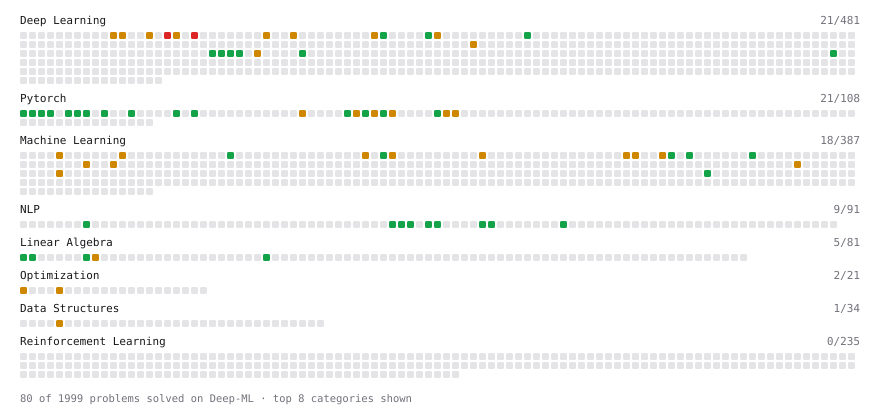

# Deep-ML

My machine learning practice from [Deep-ML](https://www.deep-ml.com). Every solution here was written by hand.

**92** solved · 76 problems · 2 labs · 14 math

[**Browse the interactive portfolio**](https://mittaltanmay.github.io/deep-ml/) to replay this filling in over time.

## Problems

| | Difficulty | Solved | |
| --- | --- | --- | --- |
| [Adagrad Optimizer](https://www.deep-ml.com/problems/145) | easy | 2026-11-01 | [solution](problems/0145-adagrad-optimizer) |
| [Add a Bias Vector to a Batch via Broadcasting](https://www.deep-ml.com/problems/882) | easy | 2026-10-23 | [solution](problems/0882-add-a-bias-vector-to-a-batch-via-broadcasting) |
| [Add Positional Embeddings to Token Embeddings](https://www.deep-ml.com/problems/946) | easy | 2026-11-12 | [solution](problems/0946-add-positional-embeddings-to-token-embeddings) |
| [Apply Dropout to Attention Weights](https://www.deep-ml.com/problems/956) | easy | 2026-11-12 | [solution](problems/0956-apply-dropout-to-attention-weights) |
| [Backprop a Linear Layer by Hand](https://www.deep-ml.com/problems/898) | easy | 2026-10-26 | [solution](problems/0898-backprop-a-linear-layer-by-hand) |
| [Balance Dataset via Undersampling](https://www.deep-ml.com/problems/1057) | easy | 2026-10-03 | [solution](problems/1057-balance-dataset-via-undersampling) |
| [Build a Linear Regression Model with nn.Module](https://www.deep-ml.com/problems/885) | easy | 2026-11-01 | [solution](problems/0885-build-a-linear-regression-model-with-nn-module) |
| [Build an MLP with nn.Sequential](https://www.deep-ml.com/problems/887) | easy | 2026-09-15 | [solution](problems/0887-build-an-mlp-with-nn-sequential) |
| [Build Vocabulary from Token List](https://www.deep-ml.com/problems/941) | easy | 2026-11-11 | [solution](problems/0941-build-vocabulary-from-token-list) |
| [Calculate 2x2 Matrix Inverse](https://www.deep-ml.com/problems/8) | easy | 2026-10-29 | [solution](problems/0008-calculate-2x2-matrix-inverse) |
| [Calculate Perplexity for Language Models](https://www.deep-ml.com/problems/320) | easy | 2026-11-10 | [solution](problems/0320-calculate-perplexity-for-language-models) |
| [Calculate Vocabulary Size from Token List](https://www.deep-ml.com/problems/953) | easy | 2026-11-11 | [solution](problems/0953-calculate-vocabulary-size-from-token-list) |
| [Construct Next-Token Prediction Targets](https://www.deep-ml.com/problems/954) | easy | 2026-11-12 | [solution](problems/0954-construct-next-token-prediction-targets) |
| [Create a Float Tensor from a Python List](https://www.deep-ml.com/problems/880) | easy | 2026-10-23 | [solution](problems/0880-create-a-float-tensor-from-a-python-list) |
| [Derivatives of Activation Functions](https://www.deep-ml.com/problems/217) | easy | 2026-10-22 | [solution](problems/0217-derivatives-of-activation-functions) |
| [Dot Product Calculator](https://www.deep-ml.com/problems/83) | easy | 2026-10-29 | [solution](problems/0083-dot-product-calculator) |
| [Embedding Layer as One-Hot Matrix Multiplication](https://www.deep-ml.com/problems/947) | easy | 2026-11-12 | [solution](problems/0947-embedding-layer-as-one-hot-matrix-multiplication) |
| [Find Most Frequent Token Pair for BPE](https://www.deep-ml.com/problems/948) | easy | 2026-11-11 | [solution](problems/0948-find-most-frequent-token-pair-for-bpe) |
| [Generate Input-Target Batches for Language Model Training](https://www.deep-ml.com/problems/1080) | easy | 2026-11-12 | [solution](problems/1080-generate-input-target-batches-for-language-model-training) |
| [Implement a Linear Layer Forward Pass with Matrix Multiplication](https://www.deep-ml.com/problems/883) | easy | 2026-10-23 | [solution](problems/0883-implement-a-linear-layer-forward-pass-with-matrix-multiplication) |
| [Implement Dropout from Scratch](https://www.deep-ml.com/problems/901) | easy | 2026-11-08 | [solution](problems/0901-implement-dropout-from-scratch) |
| [Implement Early Stopping Based on Validation Loss](https://www.deep-ml.com/problems/135) | easy | 2026-09-20 | [solution](problems/0135-implement-early-stopping-based-on-validation-loss) |
| [Implement Gini Impurity Calculation for a Set of Classes](https://www.deep-ml.com/problems/64) | easy | 2026-09-20 | [solution](problems/0064-implement-gini-impurity-calculation-for-a-set-of-classes) |
| [Implement Hard Voting Classifier](https://www.deep-ml.com/problems/305) | easy | 2026-10-12 | [solution](problems/0305-implement-hard-voting-classifier) |
| [Implement Hinge Loss for SVM](https://www.deep-ml.com/problems/283) | easy | 2026-10-01 | [solution](problems/0283-implement-hinge-loss-for-svm) |
| [Implement LayerNorm from Scratch](https://www.deep-ml.com/problems/908) | easy | 2026-11-08 | [solution](problems/0908-implement-layernorm-from-scratch) |
| [Implement Polynomial Kernel Function](https://www.deep-ml.com/problems/281) | easy | 2026-10-02 | [solution](problems/0281-implement-polynomial-kernel-function) |
| [Implement ReLU and Leaky ReLU](https://www.deep-ml.com/problems/1226) | easy | 2026-10-25 | [solution](problems/1226-implement-relu-and-leaky-relu) |
| [Matrix-Vector Dot Product](https://www.deep-ml.com/problems/1) | easy | 2026-10-29 | [solution](problems/0001-matrix-vector-dot-product) |
| [Mean Squared Error from Scratch](https://www.deep-ml.com/problems/1228) | easy | 2026-10-25 | [solution](problems/1228-mean-squared-error-from-scratch) |
| [Nesterov Accelerated Gradient Optimizer](https://www.deep-ml.com/problems/150) | easy | 2026-10-31 | [solution](problems/0150-nesterov-accelerated-gradient-optimizer) |
| [One SGD Update Step](https://www.deep-ml.com/problems/1234) | easy | 2026-11-01 | [solution](problems/1234-one-sgd-update-step) |
| [Pad and Truncate Tokenized Sequences](https://www.deep-ml.com/problems/1059) | easy | 2026-11-12 | [solution](problems/1059-pad-and-truncate-tokenized-sequences) |
| [Regex-Based Text Tokenizer](https://www.deep-ml.com/problems/940) | easy | 2026-11-10 | [solution](problems/0940-regex-based-text-tokenizer) |
| [Reshape and Transpose a Tensor](https://www.deep-ml.com/problems/881) | easy | 2026-10-23 | [solution](problems/0881-reshape-and-transpose-a-tensor) |
| [Run One Training Step: Forward, Loss, Backward, Optimizer](https://www.deep-ml.com/problems/886) | easy | 2026-11-05 | [solution](problems/0886-run-one-training-step-forward-loss-backward-optimizer) |
| [Scale Attention Scores by sqrt(d_k)](https://www.deep-ml.com/problems/963) | easy | 2026-11-12 | [solution](problems/0963-scale-attention-scores-by-sqrt-d-k) |
| [Simple Self-Attention Without Trainable Weights](https://www.deep-ml.com/problems/955) | easy | 2026-11-12 | [solution](problems/0955-simple-self-attention-without-trainable-weights) |
| [Simple Word Tokenizer Encode and Decode](https://www.deep-ml.com/problems/942) | easy | 2026-11-11 | [solution](problems/0942-simple-word-tokenizer-encode-and-decode) |
| [Single Linear Neuron Forward](https://www.deep-ml.com/problems/1224) | easy | 2026-10-25 | [solution](problems/1224-single-linear-neuron-forward) |
| [Sinusoidal Positional Encoding](https://www.deep-ml.com/problems/906) | easy | 2026-11-10 | [solution](problems/0906-sinusoidal-positional-encoding) |
| [Sliding Window Text Dataset Generator](https://www.deep-ml.com/problems/944) | easy | 2026-11-12 | [solution](problems/0944-sliding-window-text-dataset-generator) |
| [Transpose of a Matrix](https://www.deep-ml.com/problems/2) | easy | 2026-10-29 | [solution](problems/0002-transpose-of-a-matrix) |
| [Adam Optimizer](https://www.deep-ml.com/problems/87) | medium | 2026-11-01 | [solution](problems/0087-adam-optimizer) |
| [Binary Cross-Entropy from Logits](https://www.deep-ml.com/problems/1229) | medium | 2026-10-25 | [solution](problems/1229-binary-cross-entropy-from-logits) |
| [Calculate AUC (Area Under ROC Curve)](https://www.deep-ml.com/problems/277) | medium | 2026-10-06 | [solution](problems/0277-calculate-auc-area-under-roc-curve) |
| [Calculate Explained Variance Ratio for PCA](https://www.deep-ml.com/problems/350) | medium | 2026-09-26 | [solution](problems/0350-calculate-explained-variance-ratio-for-pca) |
| [Derivative of Cross-Entropy Loss w.r.t. Logits](https://www.deep-ml.com/problems/220) | medium | 2026-10-25 | [solution](problems/0220-derivative-of-cross-entropy-loss-w-r-t-logits) |
| [Derivative of Softmax](https://www.deep-ml.com/problems/219) | medium | 2026-10-23 | [solution](problems/0219-derivative-of-softmax) |
| [Dropout Layer](https://www.deep-ml.com/problems/151) | medium | 2026-11-07 | [solution](problems/0151-dropout-layer) |
| [Entropy & Cross-Entropy](https://www.deep-ml.com/problems/205) | medium | 2026-11-10 | [solution](problems/0205-entropy-cross-entropy) |
| [Find the Best Gini-Based Split for a Binary Decision Tree](https://www.deep-ml.com/problems/138) | medium | 2026-09-20 | [solution](problems/0138-find-the-best-gini-based-split-for-a-binary-decision-tree) |
| [Generate Sorted Polynomial Features](https://www.deep-ml.com/problems/32) | medium | 2026-09-19 | [solution](problems/0032-generate-sorted-polynomial-features) |
| [Handle Imbalanced Data with SMOTE](https://www.deep-ml.com/problems/357) | medium | 2026-10-02 | [solution](problems/0357-handle-imbalanced-data-with-smote) |
| [Implement Adam Optimization Algorithm](https://www.deep-ml.com/problems/49) | medium | 2026-11-01 | [solution](problems/0049-implement-adam-optimization-algorithm) |
| [Implement AdamW Optimizer Step](https://www.deep-ml.com/problems/169) | medium | 2026-11-01 | [solution](problems/0169-implement-adamw-optimizer-step) |
| [Implement Batch Normalization for BCHW Input](https://www.deep-ml.com/problems/115) | medium | 2026-11-07 | [solution](problems/0115-implement-batch-normalization-for-bchw-input) |
| [Implement K-Fold Cross-Validation](https://www.deep-ml.com/problems/18) | medium | 2026-09-26 | [solution](problems/0018-implement-k-fold-cross-validation) |
| [Implement K-Nearest Neighbors](https://www.deep-ml.com/problems/173) | medium | 2026-09-23 | [solution](problems/0173-implement-k-nearest-neighbors) |
| [Implement Layer Normalization for Sequence Data](https://www.deep-ml.com/problems/109) | medium | 2026-11-07 | [solution](problems/0109-implement-layer-normalization-for-sequence-data) |
| [Implement Long Short-Term Memory (LSTM) Network](https://www.deep-ml.com/problems/59) | medium | 2026-11-10 | [solution](problems/0059-implement-long-short-term-memory-lstm-network) |
| [Implement Masked Self-Attention](https://www.deep-ml.com/problems/107) | medium | 2026-11-10 | [solution](problems/0107-implement-masked-self-attention) |
| [Implement RBF (Gaussian) Kernel Function](https://www.deep-ml.com/problems/280) | medium | 2026-10-02 | [solution](problems/0280-implement-rbf-gaussian-kernel-function) |
| [Implement RMSProp Optimizer](https://www.deep-ml.com/problems/200) | medium | 2026-10-31 | [solution](problems/0200-implement-rmsprop-optimizer) |
| [Implement ROC Curve Calculation](https://www.deep-ml.com/problems/276) | medium | 2026-10-04 | [solution](problems/0276-implement-roc-curve-calculation) |
| [Instance Normalization (IN) Implementation](https://www.deep-ml.com/problems/143) | medium | 2026-11-07 | [solution](problems/0143-instance-normalization-in-implementation) |
| [Matrix times Matrix ](https://www.deep-ml.com/problems/9) | medium | 2026-10-29 | [solution](problems/0009-matrix-times-matrix) |
| [Numerically Stable Softmax](https://www.deep-ml.com/problems/1227) | medium | 2026-10-25 | [solution](problems/1227-numerically-stable-softmax) |
| [One Adam Update Step](https://www.deep-ml.com/problems/1236) | medium | 2026-11-01 | [solution](problems/1236-one-adam-update-step) |
| [One Training Step](https://www.deep-ml.com/problems/1219) | medium | 2026-11-05 | [solution](problems/1219-one-training-step) |
| [Permutation Feature Importance](https://www.deep-ml.com/problems/812) | medium | 2026-10-08 | [solution](problems/0812-permutation-feature-importance) |
| [Polynomial Regression Fit](https://www.deep-ml.com/problems/801) | medium | 2026-09-19 | [solution](problems/0801-polynomial-regression-fit) |
| [Reconstruction Error from PCA](https://www.deep-ml.com/problems/353) | medium | 2026-09-26 | [solution](problems/0353-reconstruction-error-from-pca) |
| [SGD with Momentum Step](https://www.deep-ml.com/problems/1235) | medium | 2026-11-01 | [solution](problems/1235-sgd-with-momentum-step) |
| [Two-Layer MLP Forward Pass](https://www.deep-ml.com/problems/1225) | medium | 2026-10-25 | [solution](problems/1225-two-layer-mlp-forward-pass) |
| [Implement Multi-Head Attention](https://www.deep-ml.com/problems/94) | hard | 2026-11-10 | [solution](problems/0094-implement-multi-head-attention) |

## Labs

| | Difficulty | Solved | |
| --- | --- | --- | --- |
| [Design Your Own Activation Function](https://www.deep-ml.com/labs/9) | easy | 2026-10-24 | [solution](labs/0009-design-your-own-activation-function) |
| [MNIST: Classification Loss (with Gradient)](https://www.deep-ml.com/labs/4) | hard | 2026-10-26 | [solution](labs/0004-mnist-classification-loss-with-gradient) |

## Math

| | Difficulty | Solved | |
| --- | --- | --- | --- |
| [Matrix Basics](https://www.deep-ml.com/math-problems/9) | easy | 2026-10-29 | [solution](math/0009-matrix-basics) |
| [Vector Operations](https://www.deep-ml.com/math-problems/7) | easy | 2026-10-29 | [solution](math/0007-vector-operations) |
| [Backpropagation and the Chain Rule](https://www.deep-ml.com/math-problems/4) | medium | 2026-10-25 | [solution](math/0004-backpropagation-and-the-chain-rule) |
| [Inverse and Rank](https://www.deep-ml.com/math-problems/12) | medium | 2026-10-29 | [solution](math/0012-inverse-and-rank) |
| [Margins and Soft-Margin SVMs](https://www.deep-ml.com/math-problems/42) | medium | 2026-09-28 | [solution](math/0042-margins-and-soft-margin-svms) |
| [Matrix Calculus Identities](https://www.deep-ml.com/math-problems/35) | medium | 2026-10-25 | [solution](math/0035-matrix-calculus-identities) |
| [Matrix Multiplication](https://www.deep-ml.com/math-problems/10) | medium | 2026-10-29 | [solution](math/0010-matrix-multiplication) |
| [Multivariate Gaussians](https://www.deep-ml.com/math-problems/36) | medium | 2026-10-11 | [solution](math/0036-multivariate-gaussians) |
| [Neural Network Derivatives](https://www.deep-ml.com/math-problems/3) | medium | 2026-10-25 | [solution](math/0003-neural-network-derivatives) |
| [Softmax and Cross-Entropy](https://www.deep-ml.com/math-problems/32) | medium | 2026-10-21 | [solution](math/0032-softmax-and-cross-entropy) |
| [Solving Linear Systems](https://www.deep-ml.com/math-problems/13) | medium | 2026-10-29 | [solution](math/0013-solving-linear-systems) |
| [Taylor Expansions and Local Quadratic Models](https://www.deep-ml.com/math-problems/37) | medium | 2026-11-05 | [solution](math/0037-taylor-expansions-and-local-quadratic-models) |
| [KL Divergence](https://www.deep-ml.com/math-problems/25) | hard | 2026-10-11 | [solution](math/0025-kl-divergence) |
| [Matrix Decompositions: LU and QR](https://www.deep-ml.com/math-problems/15) | hard | 2026-10-29 | [solution](math/0015-matrix-decompositions-lu-and-qr) |

---

_This file is regenerated by Deep-ML on every push._
